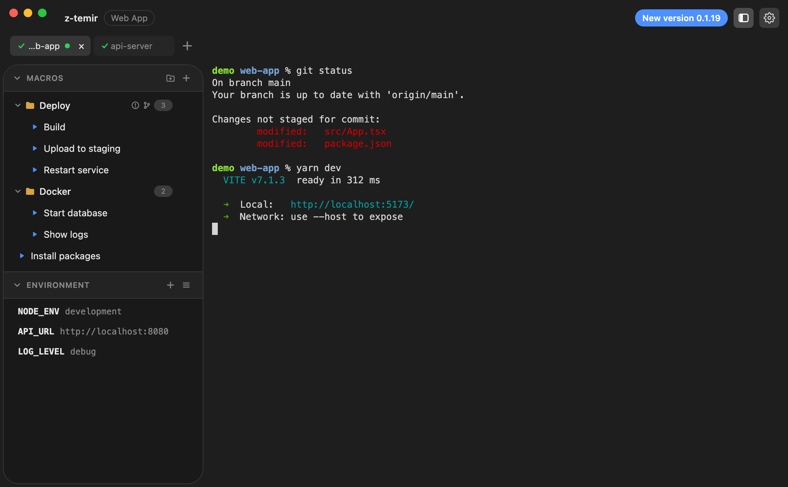
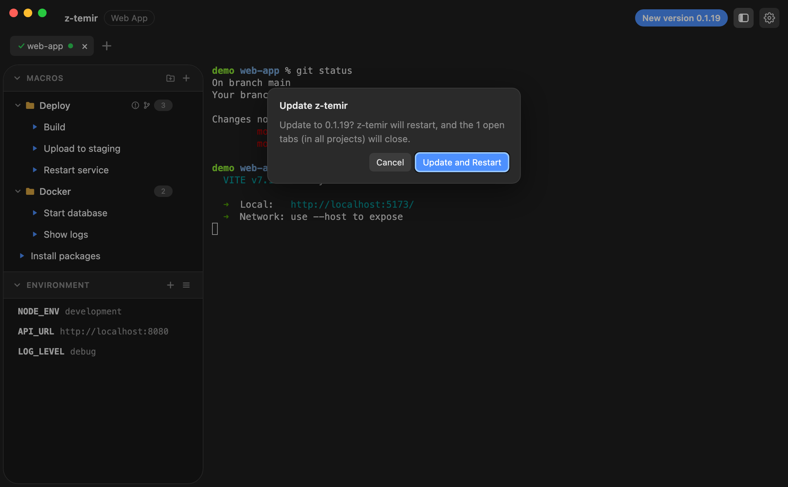
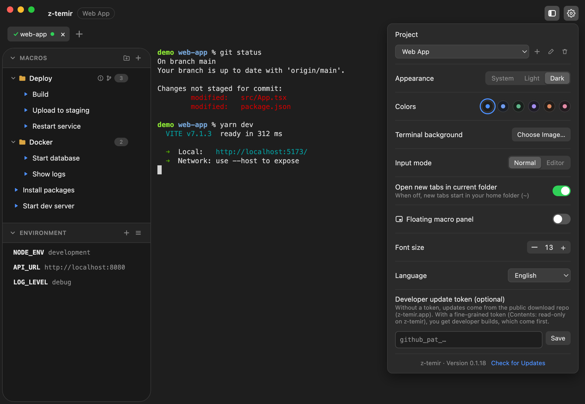
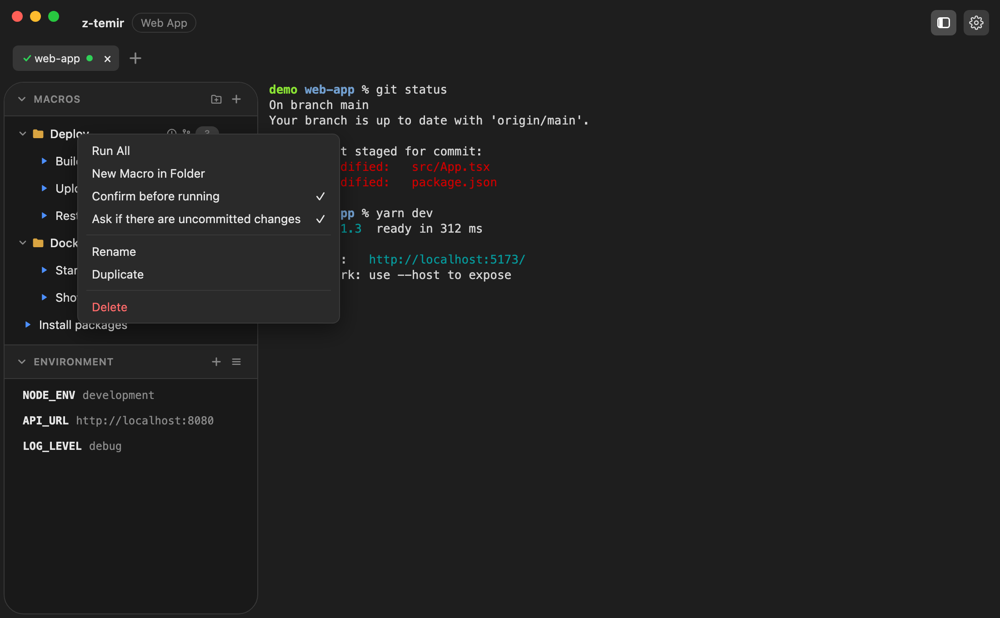
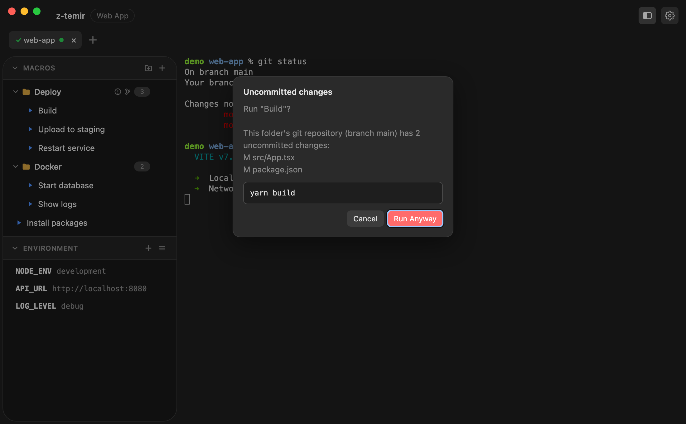
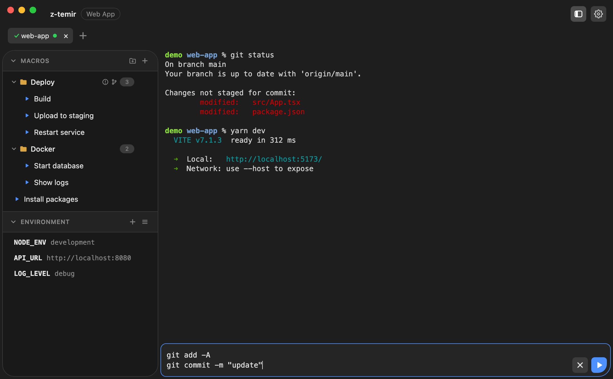
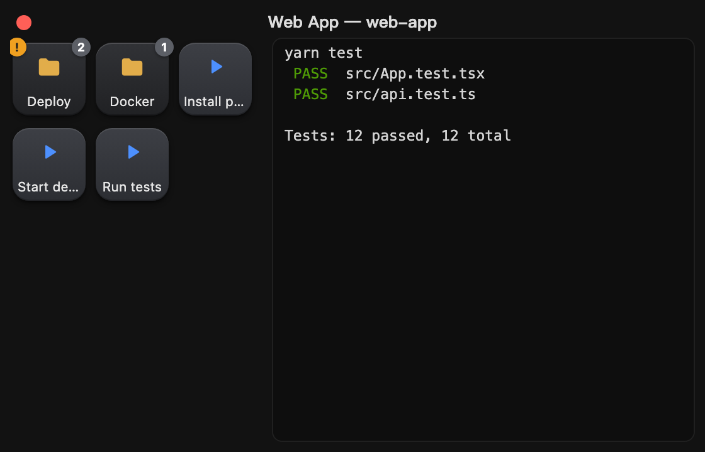

# z-temir

**English** · [繁體中文](README.md) · [简体中文](README.zh-CN.md) · [日本語](README.ja.md)

z-temir is a terminal for developers: tabs, projects, macros (run your usual commands with one click), environment variables, and a floating macro panel that stays on top. It runs on macOS, Windows and Linux.

Latest version: **0.1.18**

| Platform | Download |
|---|---|
| macOS (Apple silicon M1/M2/M3…) | [z-temir-0.1.18-macos-arm64.zip](releases/0.1.18/z-temir-0.1.18-macos-arm64.zip) |
| macOS (Intel) | [z-temir-0.1.18-macos-amd64.zip](releases/0.1.18/z-temir-0.1.18-macos-amd64.zip) |
| Windows (x64) | [z-temir-0.1.18-windows-amd64.zip](releases/0.1.18/z-temir-0.1.18-windows-amd64.zip) |
| Windows (ARM) | [z-temir-0.1.18-windows-arm64.zip](releases/0.1.18/z-temir-0.1.18-windows-arm64.zip) |
| Linux (x64) | [z-temir-0.1.18-linux-amd64.tar.gz](releases/0.1.18/z-temir-0.1.18-linux-amd64.tar.gz) |

Each version's folder has the files' SHA-256 checksums in `SHA256SUMS.txt`.

## Install

- **macOS**: unzip and drag `z-temir.app` to Applications. If the first launch says Apple cannot verify the developer, go to System Settings → Privacy & Security and click "Open Anyway".
- **Windows**: unzip and run `z-temir.exe`. Needs Windows 10 1809 or later and the WebView2 Runtime (built into Windows 11).
- **Linux**: unpack and run `./install.sh` (installs to `~/.local/bin`). Needs GTK 3 and WebKitGTK 4.1, e.g. `sudo apt install libgtk-3-0 libwebkit2gtk-4.1-0`.

## Updates

### Automatic updates (0.1.18 and later)

z-temir checks for a new version at startup and every 6 hours after that. When there is one, a blue "**New version x.y.z**" button appears at the top right of the title bar:

Click it and confirm, and z-temir:

1. downloads the package for your computer;
2. checks it against `SHA256SUMS.txt` and stops if it doesn't match;
3. replaces itself with the new version and reopens.

Notes:

- When it reopens, **all tabs close** and running commands stop, so save your work first.
- To check right away, open Settings (⚙ at the top right) and click "**Check for Updates**" at the bottom.
- A new version shows up a few minutes after its release (GitHub's cache).
- z-temir needs write access to the folder it is in. On macOS, in Applications, that means an administrator account.
- On macOS, an automatically updated z-temir doesn't show the "cannot verify the developer" warning.

Leave "Developer update token" in Settings empty. Without it, z-temir gets public updates from this repository.

### Manual update

Versions up to 0.1.17c can't update from this repository on their own, so update them by hand once:

1. download the latest version as described in "Install";
2. replace the old one (macOS: drag it to Applications and choose "Replace"; Windows: overwrite `z-temir.exe`; Linux: run `./install.sh` again).

Your settings, projects, macros and environment variables are kept.

## Usage

### Tabs

- The tabs are below the title bar; each one is a shell. Click **+** for a new tab.
- A tab is named after its current folder. A green ✓ in front means environment variables are applied to it.
- A pulsing green light means a command has been running in the tab for more than 2 seconds (e.g. `yarn dev`, `go run .`). Hover over it to see the command.
- **Drag** a tab to move it; press Esc while dragging to cancel.
- **Right-click** a tab to "Rename" it, "Use Folder Name" again, or "Close Tab".
- Turn on "Open new tabs in current folder" in Settings to start new tabs in the current tab's folder.

### Projects

The label next to "z-temir" in the title bar is the current project. Each project has its own tabs, macros and environment variables; nothing is shared.

At the top of Settings you can switch, add (＋), rename (✎) or delete projects. Other projects' tabs keep running in the background when you switch.

### Macros

The top half of the sidebar (the first button at the top right shows or hides it) holds your macros, saved commands:

- **Click** a macro to run it in the current tab. Hover to see its commands; click the pencil to edit it.
- The folder button in the header adds a folder, ＋ adds a macro. A macro can have several lines.
- Drag macros to reorder them or move them into a folder.
- **Right-click** a folder for:
  - **Run All**: runs its macros in order and stops at the first failure;
  - **Confirm before running**: asks before running;
  - **Ask if there are uncommitted changes**: warns first when the current folder's git repository has uncommitted files;
  - Rename, Duplicate, Delete.

A macro that asks before running shows the commands it will run. With the git check on and uncommitted changes in the current folder, it also lists the changed files:

### Environment variables

The bottom half of the sidebar holds the project's environment variables (`KEY = value`). Click a row to edit it; ＋ adds one.

The ☰ menu can:

- **Apply to Current Tab**: new tabs of the project get them too from then on;
- **Revoke from Current Tab**;
- import or export a `.env` file;
- Clear All.

Applying and revoking leave no command or history entry in the terminal.

### Editor mode

Set "Input mode" in Settings to "**Editor**" for an input box below the terminal, handy for multi-line commands:

- **Enter** starts a new line;
- **⌘Enter** (Ctrl+Enter on Windows/Linux) or ▶ runs it.

### Floating macro panel

Turn on "**Floating macro panel**" in Settings for a small window that stays on top of others. On the left are the current project's macros (click a folder to open it); on the right, the output of the last macro run from the panel. While a command runs, the red ■ stops it.

The panel's macros run in the main window's current tab, and they ask before running the same way as in the sidebar.

### Appearance

In Settings you can change:

- the appearance (System, Light, Dark);
- the colors (6 palettes);
- a terminal background image and how much it is shaded;
- the font size;
- the language (English, 繁體中文, 简体中文, 日本語).

### Keyboard shortcuts

| Action | macOS | Windows / Linux |
|---|---|---|
| New tab | ⌘T | Ctrl+Shift+T |
| Close tab | ⌘W | Ctrl+Shift+W |
| Next / previous tab | ⌘⇧] / ⌘⇧[ | Ctrl+Tab / Ctrl+Shift+Tab |
| Go to tab 1–8 | ⌘1–⌘8 | Alt+1–8 |
| Go to the last tab | ⌘9 | Alt+9 |
| Settings | ⌘, | Ctrl+, |
| Copy / paste | ⌘C / ⌘V | Ctrl+Shift+C / Ctrl+Shift+V |
| Open a link | ⌘-click | Ctrl-click |

### Opening folders with z-temir (macOS)

Like the Terminal app:

- `open -a z-temir ~/projects/web-app` opens a new tab in that folder; so does dropping a folder on z-temir's Dock icon.
- `open -a z-temir script.sh` runs the script in a new tab.

React Native's `run-ios` opens Metro this way.

## All versions

- [0.1.18](releases/0.1.18)
- [0.1.17c](releases/0.1.17c)
