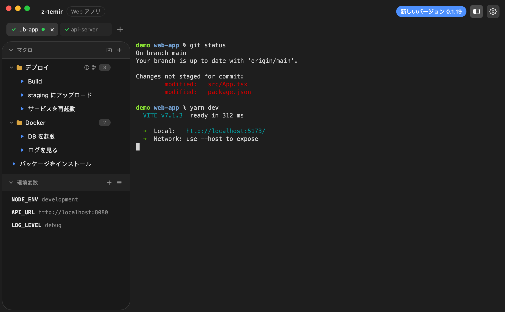
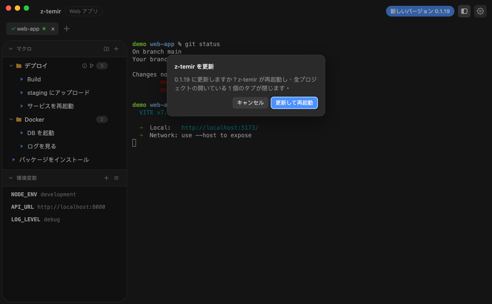
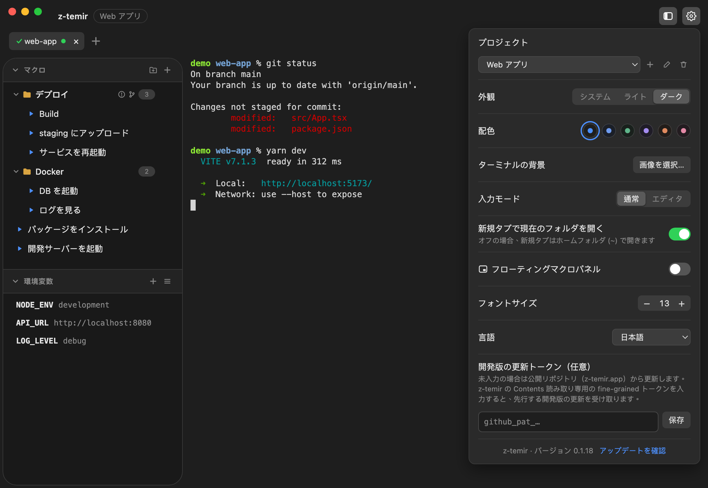
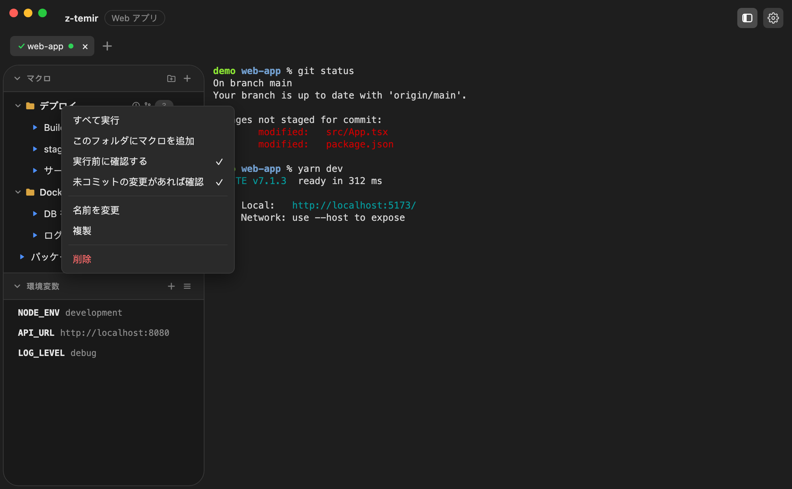
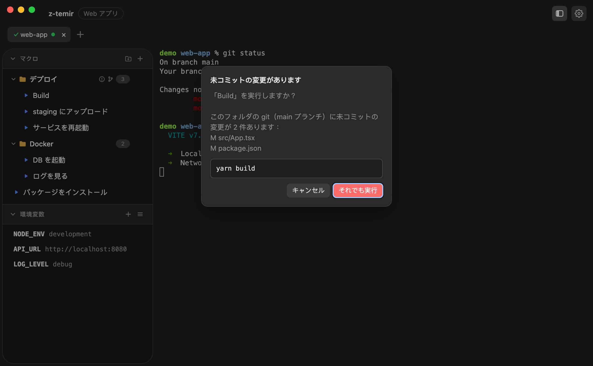
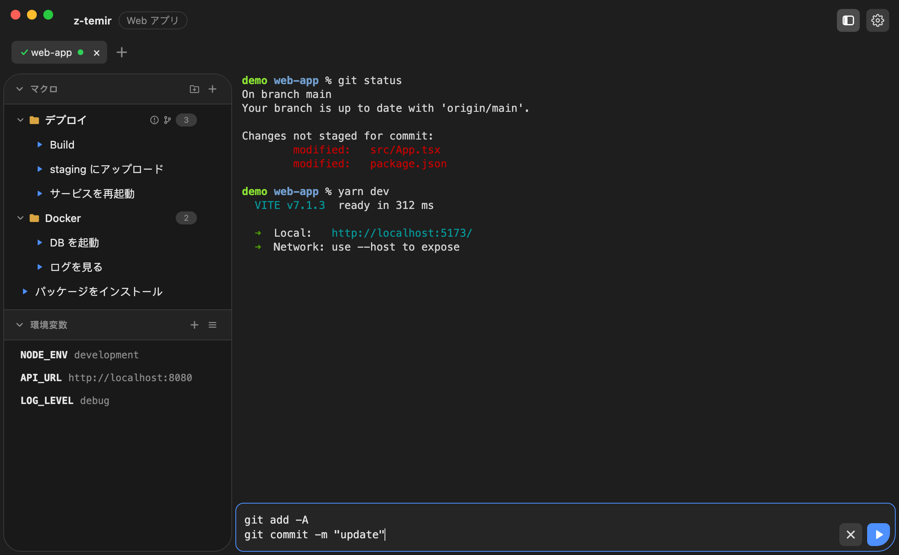
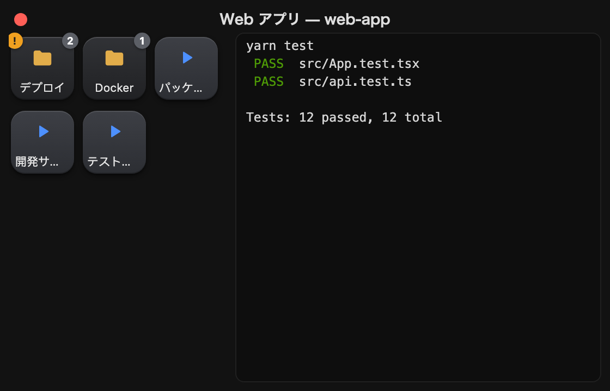

# z-temir

[English](README.en.md) · [繁體中文](README.md) · [简体中文](README.zh-CN.md) · **日本語**

z-temir は開発者向けのターミナルです。タブ、プロジェクト、マクロ（よく使うコマンドをワンクリックで実行）、環境変数、常に最前面に表示できるマクロパネルを備えています。macOS、Windows、Linux に対応しています。

最新バージョン：**0.1.18**

| プラットフォーム | ダウンロード |
|---|---|
| macOS（Apple シリコン M1/M2/M3…） | [z-temir-0.1.18-macos-arm64.zip](releases/0.1.18/z-temir-0.1.18-macos-arm64.zip) |
| macOS（Intel） | [z-temir-0.1.18-macos-amd64.zip](releases/0.1.18/z-temir-0.1.18-macos-amd64.zip) |
| Windows（x64） | [z-temir-0.1.18-windows-amd64.zip](releases/0.1.18/z-temir-0.1.18-windows-amd64.zip) |
| Windows（ARM） | [z-temir-0.1.18-windows-arm64.zip](releases/0.1.18/z-temir-0.1.18-windows-arm64.zip) |
| Linux（x64） | [z-temir-0.1.18-linux-amd64.tar.gz](releases/0.1.18/z-temir-0.1.18-linux-amd64.tar.gz) |

各バージョンのフォルダにある `SHA256SUMS.txt` に、ファイルの SHA-256 が載っています。

## インストール

- **macOS**：展開した `z-temir.app` を「アプリケーション」にドラッグします。初回起動時に「開発元を検証できません」と表示された場合は、「システム設定 → プライバシーとセキュリティ」で「このまま開く」をクリックしてください。
- **Windows**：展開して `z-temir.exe` を実行します。Windows 10 1809 以降と WebView2 Runtime（Windows 11 には標準搭載）が必要です。
- **Linux**：展開して `./install.sh` を実行します（`~/.local/bin` にインストールされます）。GTK 3 と WebKitGTK 4.1 が必要です（例：`sudo apt install libgtk-3-0 libwebkit2gtk-4.1-0`）。

## アップデート

### 自動アップデート（0.1.18 以降）

z-temir は起動時と、その後 6 時間ごとに新しいバージョンを確認します。新しいバージョンがあると、タイトルバー右上に青い「**新しいバージョン x.y.z**」ボタンが表示されます：

クリックして確認すると、z-temir は次のことを行います：

1. このコンピュータ用のパッケージをダウンロード；
2. `SHA256SUMS.txt` で検証し、一致しなければ中止；
3. 新しいバージョンに置き換えて自動で再起動。

注意：

- 再起動すると**すべてのタブが閉じ**、実行中のコマンドも止まります。先に作業を保存してください。
- すぐに確認したいときは、設定（右上の ⚙）の一番下にある「**アップデートを確認**」をクリックします。
- 新しいバージョンは公開から数分後に見つかるようになります（GitHub のキャッシュのため）。
- z-temir が置かれているフォルダへの書き込み権限が必要です。macOS で「アプリケーション」に置いている場合は管理者アカウントが必要です。
- macOS では、自動アップデート後に「開発元を検証できません」は表示されません。

設定の「開発版の更新トークン」は空欄のままで構いません。空欄なら、このリポジトリから公開版のアップデートを受け取ります。

### 手動アップデート

0.1.17c 以前のバージョンはこのリポジトリから自動アップデートできないため、一度だけ手動で更新してください：

1. 上の「インストール」の手順で最新版をダウンロード；
2. 古いものを置き換え（macOS は「アプリケーション」にドラッグして「置き換える」、Windows は `z-temir.exe` を上書き、Linux は `./install.sh` を再実行）。

設定、プロジェクト、マクロ、環境変数はそのまま残ります。

## 使い方

### タブ

- タイトルバーの下がタブで、それぞれが 1 つのシェルです。**+** で新しいタブを開きます。
- タブ名は現在のフォルダです。先頭の緑の ✓ は、そのタブに環境変数が適用されていることを示します。
- 緑のランプが点滅しているのは、タブ内でコマンドが 2 秒以上実行中であることを示します（例：`yarn dev`、`go run .`）。マウスを重ねるとコマンドが表示されます。
- タブを**ドラッグ**すると順番を変えられます。ドラッグ中に Esc でキャンセルします。
- タブを**右クリック**すると「名前を変更」「フォルダ名に戻す」「タブを閉じる」が使えます。
- 設定の「新規タブで現在のフォルダを開く」をオンにすると、新しいタブは現在のタブのフォルダから始まります。

### プロジェクト

タイトルバーの z-temir の隣にあるラベルが現在のプロジェクトです。プロジェクトごとにタブ、マクロ、環境変数を持ち、互いに共有しません。

設定の一番上で、プロジェクトの切り替え、追加（＋）、名前の変更（✎）、削除ができます。切り替えても、ほかのプロジェクトのタブはバックグラウンドで動き続けます。

### マクロ

左のサイドバー（右上の最初のボタンで表示／非表示）の上半分がマクロで、よく使うコマンドを保存できます：

- **クリック**すると現在のタブで実行します。マウスを重ねると内容が見え、鉛筆アイコンで編集できます。
- 見出しのフォルダボタンでフォルダを、＋ でマクロを追加します。マクロは複数行にできます。
- マクロはドラッグで並べ替えたり、フォルダに入れたりできます。
- フォルダを**右クリック**すると：
  - **すべて実行**：順番に実行し、失敗したところで止まります；
  - **実行前に確認する**：実行前に確認ダイアログを出します；
  - **未コミットの変更があれば確認**：現在のフォルダの git に未コミットのファイルがあると先に警告します；
  - 名前を変更、複製、削除。

確認が必要なマクロは、実行するコマンドを先に表示します。git の確認がオンで、現在のフォルダに未コミットの変更がある場合は、変更されたファイルも一覧表示します：

### 環境変数

サイドバーの下半分は、このプロジェクトの環境変数（`KEY = value`）です。行をクリックで編集、＋ で追加します。

☰ メニューでは：

- **現在のタブに適用**：以降、このプロジェクトの新しいタブにも自動で設定されます；
- **現在のタブから取り消す**；
- `.env` の読み込み・書き出し；
- すべて消去。

適用と取り消しは、ターミナルにコマンドや履歴を残しません。

### エディタモード

設定の「入力モード」を「**エディタ**」にすると、ターミナルの下に入力欄が表示され、複数行のコマンドを書きやすくなります：

- **Enter** で改行；
- **⌘Enter**（Windows/Linux では Ctrl+Enter）または ▶ で実行。

### フローティングマクロパネル

設定で「**フローティングマクロパネル**」をオンにすると、常に最前面に表示される小さなウィンドウが開きます。左は現在のプロジェクトのマクロ（フォルダをクリックで展開）、右はパネルから最後に実行したマクロの出力です。コマンドの実行中は赤い ■ で停止できます。

パネルのマクロはメインウィンドウの現在のタブで実行され、確認と git チェックのルールはサイドバーと同じです。

### 外観

設定で次のものを変更できます：

- 外観（システム、ライト、ダーク）；
- 配色（6 種類）；
- ターミナルの背景画像と、その暗さ；
- フォントサイズ；
- 言語（English、繁體中文、简体中文、日本語）。

### キーボードショートカット

| 操作 | macOS | Windows / Linux |
|---|---|---|
| 新規タブ | ⌘T | Ctrl+Shift+T |
| タブを閉じる | ⌘W | Ctrl+Shift+W |
| 次 / 前のタブ | ⌘⇧] / ⌘⇧[ | Ctrl+Tab / Ctrl+Shift+Tab |
| 1〜8 番目のタブへ | ⌘1〜⌘8 | Alt+1〜8 |
| 最後のタブへ | ⌘9 | Alt+9 |
| 設定 | ⌘, | Ctrl+, |
| コピー / ペースト | ⌘C / ⌘V | Ctrl+Shift+C / Ctrl+Shift+V |
| リンクを開く | ⌘ クリック | Ctrl クリック |

### z-temir でフォルダを開く（macOS）

「ターミナル」App と同じように使えます：

- `open -a z-temir ~/projects/web-app` でそのフォルダの新しいタブが開きます。Dock の z-temir アイコンにフォルダをドロップしても同じです。
- `open -a z-temir script.sh` で新しいタブでスクリプトを実行します。

React Native の `run-ios` はこの方法で Metro を開きます。

## すべてのバージョン

- [0.1.18](releases/0.1.18)
- [0.1.17c](releases/0.1.17c)
