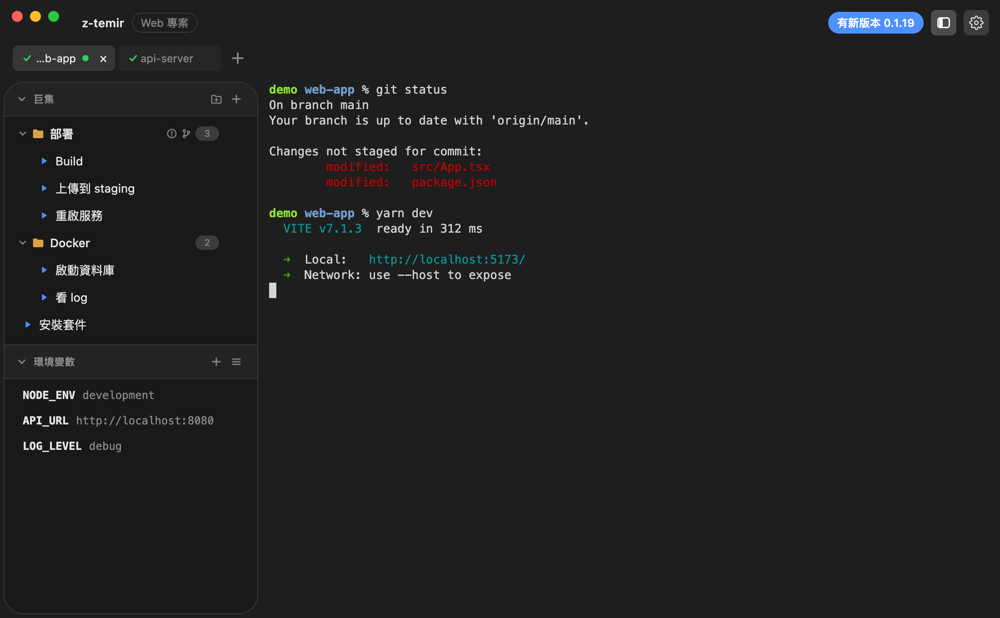
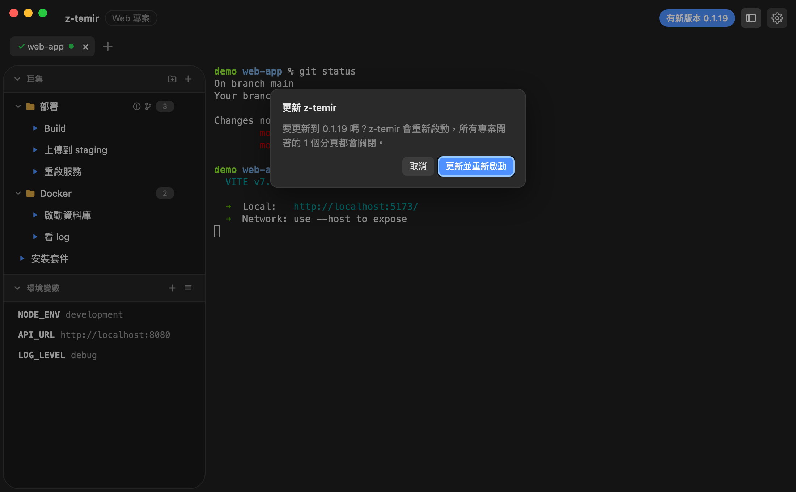
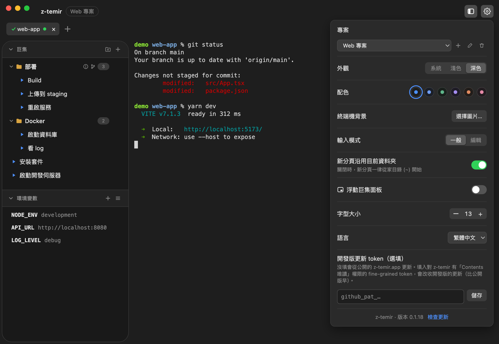
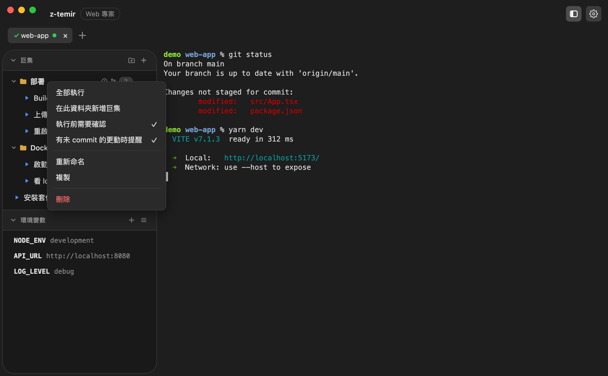
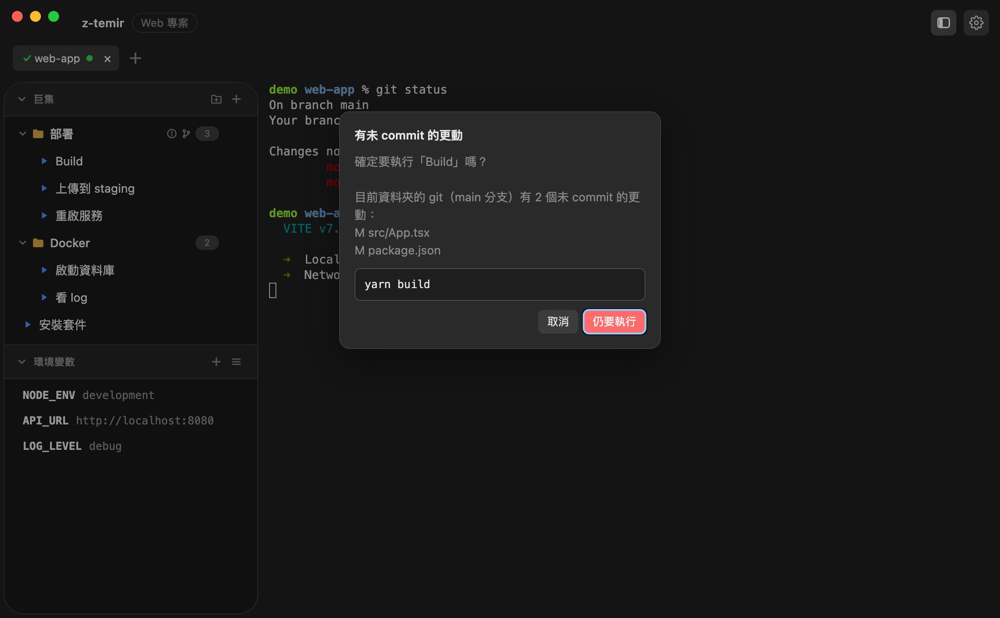
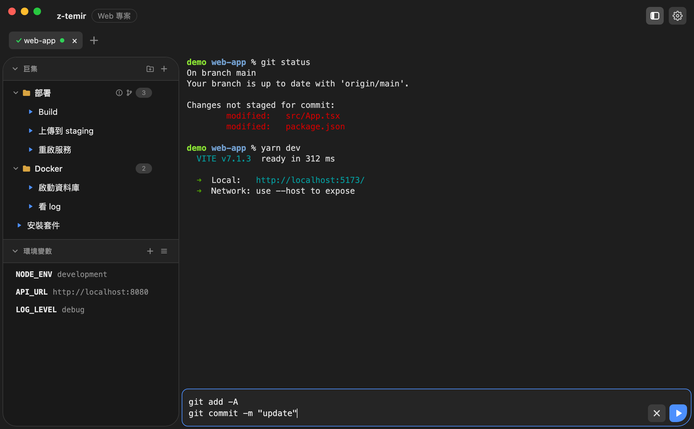
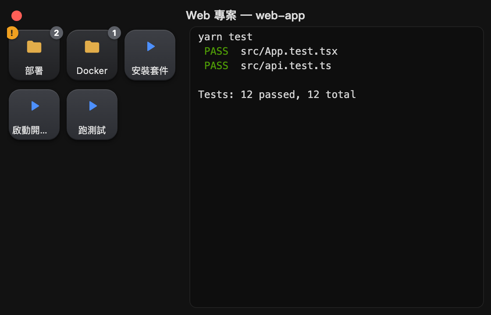

# z-temir

z-temir 是一個給開發者用的終端機：分頁、專案、巨集（一鍵執行常用指令）、環境變數，還有可以浮在最上層的巨集面板。支援 macOS、Windows 和 Linux。

最新版：**0.1.18**

| 平台 | 下載 |
|---|---|
| macOS（Apple 晶片 M1/M2/M3…） | [z-temir-0.1.18-macos-arm64.zip](releases/0.1.18/z-temir-0.1.18-macos-arm64.zip) |
| macOS（Intel） | [z-temir-0.1.18-macos-amd64.zip](releases/0.1.18/z-temir-0.1.18-macos-amd64.zip) |
| Windows（x64） | [z-temir-0.1.18-windows-amd64.zip](releases/0.1.18/z-temir-0.1.18-windows-amd64.zip) |
| Windows（ARM） | [z-temir-0.1.18-windows-arm64.zip](releases/0.1.18/z-temir-0.1.18-windows-arm64.zip) |
| Linux（x64） | [z-temir-0.1.18-linux-amd64.tar.gz](releases/0.1.18/z-temir-0.1.18-linux-amd64.tar.gz) |

檔案的 SHA-256 在各版本資料夾的 `SHA256SUMS.txt`。

## 安裝

- **macOS**：解壓縮後把 `z-temir.app` 拖到「應用程式」。第一次打開若出現「無法驗證開發者」，到「系統設定 → 隱私權與安全性」按「強制打開」。
- **Windows**：解壓縮後執行 `z-temir.exe`。需要 Windows 10 1809 以上和 WebView2 Runtime（Windows 11 內建）。
- **Linux**：解壓縮後執行 `./install.sh`（裝到 `~/.local/bin`）。需要 GTK 3 和 WebKitGTK 4.1，例如 `sudo apt install libgtk-3-0 libwebkit2gtk-4.1-0`。

## 更新

### 自動更新（0.1.18 以後）

z-temir 會在啟動時和之後每 6 小時檢查一次有沒有新版。有新版時，標題列右上角會出現藍色的「**有新版本 x.y.z**」按鈕：

按下去確認後，z-temir 會：

1. 下載這台電腦用的安裝檔；
2. 用 `SHA256SUMS.txt` 驗證檔案，不符就取消；
3. 換成新版並自動重新開啟。

注意：

- 重新開啟時**所有分頁都會關閉**，正在跑的指令會被中斷，請先存好工作。
- 想馬上檢查，打開設定（右上角 ⚙）最下面按「**檢查更新**」。
- 新版發佈後要等幾分鐘才查得到（GitHub 的快取）。
- z-temir 要能寫入它所在的資料夾。macOS 放在「應用程式」裡需要是管理者帳號。
- macOS 自動更新後不會再跳出「無法驗證開發者」。

設定裡的「開發版更新 token」不用填。沒填就是從這個 repo 收公開版更新。

### 手動更新

0.1.17c 以前的版本沒有公開版自動更新，需要手動更新一次：

1. 照上面的「安裝」重新下載最新版；
2. 蓋掉舊的（macOS 拖進「應用程式」選「取代」，Windows 覆蓋 `z-temir.exe`，Linux 重跑 `./install.sh`）。

設定、專案、巨集和環境變數都會保留。

## 使用說明

### 分頁

- 標題列下面是分頁，每個分頁是一個 shell。按 **+** 開新分頁。
- 分頁名稱是目前所在的資料夾。前面的綠色 ✓ 表示這個分頁套用了環境變數。
- 綠燈在閃，表示分頁裡有指令跑超過 2 秒（例如 `yarn dev`、`go run .`）。滑鼠移上去會顯示是哪個指令。
- **拖曳**分頁可以調整順序，拖曳時按 Esc 取消。
- 在分頁上按**右鍵**可以「重新命名」、「使用資料夾名稱」或「關閉分頁」。
- 設定裡打開「新分頁沿用目前資料夾」，新分頁就會從目前分頁的資料夾開始。

### 專案

標題列 z-temir 旁邊的標籤是目前的專案。每個專案有自己的分頁、巨集和環境變數，彼此不共用。

在設定最上面可以切換、新增（＋）、改名（✎）或刪除專案。切換專案時，其他專案的分頁會在背景繼續跑。

### 巨集

左邊側邊欄（右上角第一個按鈕可以開關）上半部是巨集，存放常用的指令：

- **點一下**就會在目前分頁執行。滑鼠移上去可以看到內容，按鉛筆圖示可以編輯。
- 標題的資料夾按鈕新增資料夾，＋ 新增巨集。巨集可以有很多行。
- 拖曳巨集可以換順序，或拖進資料夾。
- 在資料夾上按**右鍵**：
  - **全部執行**：依序執行，遇到失敗就停；
  - **執行前需要確認**：執行前先跳出確認視窗；
  - **有未 commit 的更動時提醒**：目前資料夾的 git 有沒 commit 的檔案時先警告；
  - 重新命名、複製、刪除。

有「需要確認」的巨集會先顯示要跑的指令。有開 git 提醒、而且目前資料夾有未 commit 的更動時，會列出改了哪些檔案：

### 環境變數

側邊欄下半部是這個專案的環境變數（`KEY = value`）。點一列可以編輯，＋ 新增。

☰ 選單可以：

- **套用到目前分頁**：之後這個專案的新分頁也會自動帶入；
- **從目前分頁撤銷**；
- 匯入或匯出 `.env`；
- 全部清除。

套用和撤銷不會在終端機留下指令或歷史紀錄。

### 編輯模式

設定的「輸入模式」改成「**編輯**」後，終端機下方會出現輸入框，方便寫多行指令：

- **Enter** 換行；
- **⌘Enter**（Windows/Linux 是 Ctrl+Enter）或 ▶ 執行。

### 浮動巨集面板

設定裡打開「**浮動巨集面板**」，會多一個永遠在最上層的小視窗。左邊是目前專案的巨集，點資料夾可以展開。右邊顯示最近一次從面板執行的輸出，指令還在跑時可以按紅色 ■ 停止。

面板的巨集會在主視窗目前的分頁執行，確認和 git 提醒的規則跟側邊欄一樣。

### 外觀

設定裡可以調整：

- 外觀（跟隨系統、淺色、深色）；
- 配色（6 種）；
- 終端機背景圖片和遮罩深淺；
- 字型大小；
- 語言（English、繁體中文、简体中文、日本語）。

### 快速鍵

| 動作 | macOS | Windows / Linux |
|---|---|---|
| 新分頁 | ⌘T | Ctrl+Shift+T |
| 關閉分頁 | ⌘W | Ctrl+Shift+W |
| 下一個 / 上一個分頁 | ⌘⇧] / ⌘⇧[ | Ctrl+Tab / Ctrl+Shift+Tab |
| 切到第 1–8 個分頁 | ⌘1–⌘8 | Alt+1–8 |
| 切到最後一個分頁 | ⌘9 | Alt+9 |
| 設定 | ⌘, | Ctrl+, |
| 複製 / 貼上 | ⌘C / ⌘V | Ctrl+Shift+C / Ctrl+Shift+V |
| 開啟連結 | ⌘ 點連結 | Ctrl 點連結 |

### 用 z-temir 開資料夾（macOS）

跟「終端機」App 一樣：

- `open -a z-temir ~/projects/web-app` 會在那個資料夾開新分頁，把資料夾拖到 Dock 上的 z-temir 圖示也可以。
- `open -a z-temir script.sh` 會在新分頁執行那個腳本。

React Native 的 `run-ios` 會用這個方式開 Metro。

## 所有版本

- [0.1.18](releases/0.1.18)
- [0.1.17c](releases/0.1.17c)
