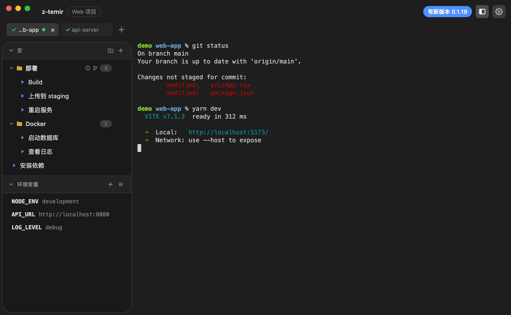
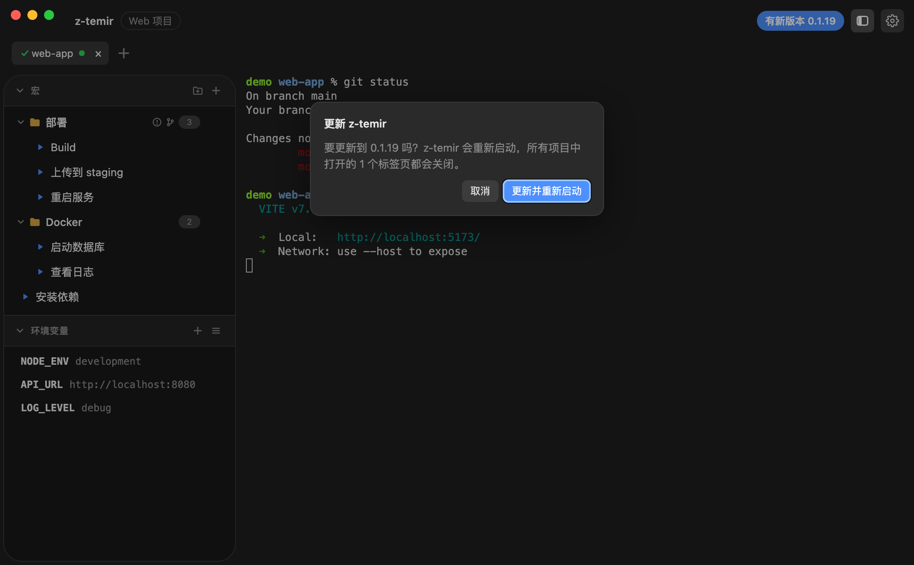
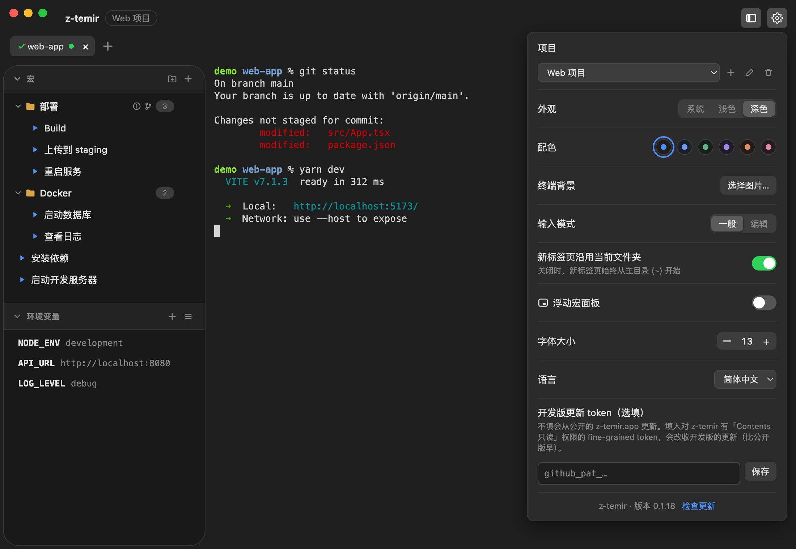
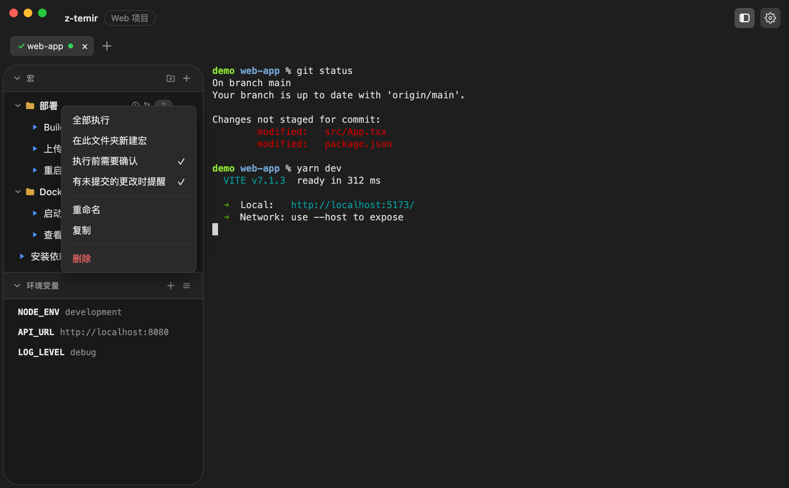
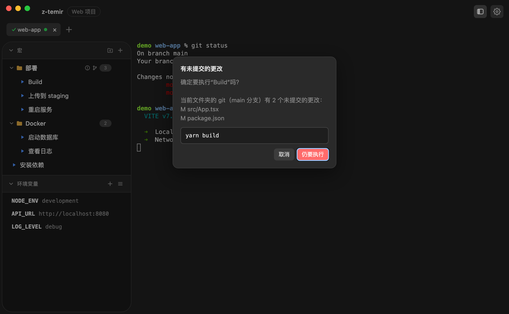
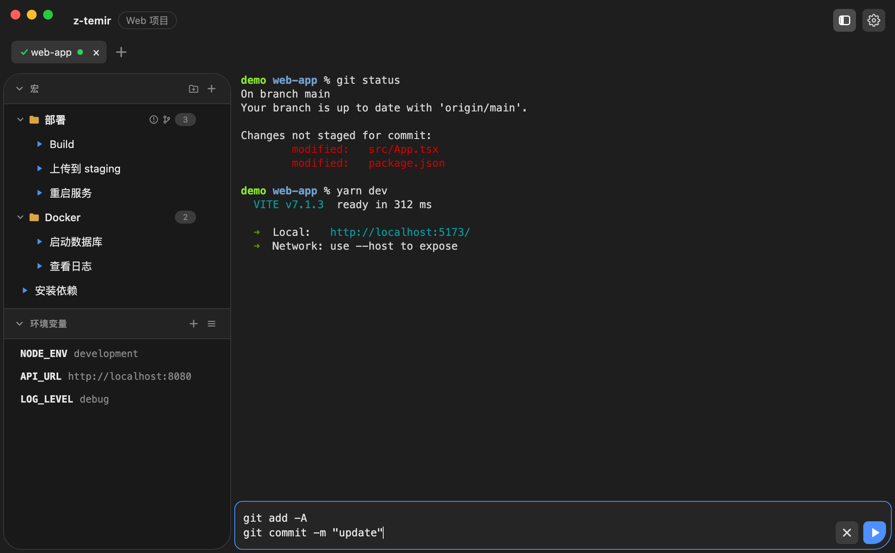
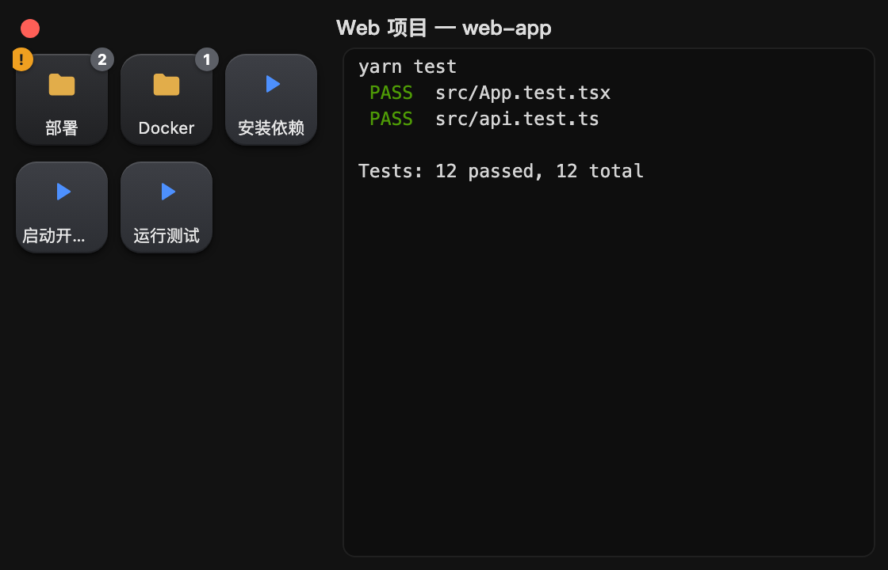

# z-temir

[English](README.en.md) · [繁體中文](README.md) · **简体中文** · [日本語](README.ja.md)

z-temir 是一个面向开发者的终端：标签页、项目、宏（一键执行常用命令）、环境变量，还有可以悬浮在最上层的宏面板。支持 macOS、Windows 和 Linux。

最新版：**0.1.18**

| 平台 | 下载 |
|---|---|
| macOS（Apple 芯片 M1/M2/M3…） | [z-temir-0.1.18-macos-arm64.zip](releases/0.1.18/z-temir-0.1.18-macos-arm64.zip) |
| macOS（Intel） | [z-temir-0.1.18-macos-amd64.zip](releases/0.1.18/z-temir-0.1.18-macos-amd64.zip) |
| Windows（x64） | [z-temir-0.1.18-windows-amd64.zip](releases/0.1.18/z-temir-0.1.18-windows-amd64.zip) |
| Windows（ARM） | [z-temir-0.1.18-windows-arm64.zip](releases/0.1.18/z-temir-0.1.18-windows-arm64.zip) |
| Linux（x64） | [z-temir-0.1.18-linux-amd64.tar.gz](releases/0.1.18/z-temir-0.1.18-linux-amd64.tar.gz) |

文件的 SHA-256 在各版本文件夹的 `SHA256SUMS.txt` 里。

## 安装

- **macOS**：解压后把 `z-temir.app` 拖到“应用程序”。第一次打开如果提示“无法验证开发者”，到“系统设置 → 隐私与安全性”点“仍要打开”。
- **Windows**：解压后运行 `z-temir.exe`。需要 Windows 10 1809 以上和 WebView2 Runtime（Windows 11 自带）。
- **Linux**：解压后运行 `./install.sh`（安装到 `~/.local/bin`）。需要 GTK 3 和 WebKitGTK 4.1，例如 `sudo apt install libgtk-3-0 libwebkit2gtk-4.1-0`。

## 更新

### 自动更新（0.1.18 及以后）

z-temir 会在启动时以及之后每 6 小时检查一次新版本。有新版本时，标题栏右上角会出现蓝色的“**有新版本 x.y.z**”按钮：

点击并确认后，z-temir 会：

1. 下载适用于这台电脑的安装包；
2. 用 `SHA256SUMS.txt` 校验文件，不一致就取消；
3. 替换为新版本并自动重新打开。

注意：

- 重新打开时**所有标签页都会关闭**，正在运行的命令会被中断，请先保存好工作。
- 想马上检查，打开设置（右上角 ⚙），在最下面点“**检查更新**”。
- 新版本发布后要等几分钟才能检查到（GitHub 的缓存）。
- z-temir 需要能写入它所在的文件夹。macOS 上放在“应用程序”里需要管理员账户。
- macOS 自动更新后不会再提示“无法验证开发者”。

设置里的“开发版更新 token”不用填。不填就会从这个仓库获取公开版更新。

### 手动更新

0.1.17c 及以前的版本没有公开版自动更新，需要手动更新一次：

1. 按上面的“安装”重新下载最新版；
2. 覆盖旧版（macOS 拖进“应用程序”选“替换”，Windows 覆盖 `z-temir.exe`，Linux 重新运行 `./install.sh`）。

设置、项目、宏和环境变量都会保留。

## 使用说明

### 标签页

- 标题栏下面是标签页，每个标签页是一个 shell。点 **+** 打开新标签页。
- 标签页名称是当前所在的文件夹。前面的绿色 ✓ 表示这个标签页应用了环境变量。
- 绿灯在闪，表示标签页里有命令运行超过 2 秒（例如 `yarn dev`、`go run .`）。鼠标移上去会显示是哪个命令。
- **拖动**标签页可以调整顺序，拖动时按 Esc 取消。
- 在标签页上点**右键**可以“重命名”、“恢复使用文件夹名称”或“关闭标签页”。
- 在设置里打开“新标签页沿用当前文件夹”，新标签页就会从当前标签页的文件夹开始。

### 项目

标题栏 z-temir 旁边的标签是当前项目。每个项目有自己的标签页、宏和环境变量，互不共享。

在设置最上面可以切换、新建（＋）、重命名（✎）或删除项目。切换项目时，其他项目的标签页会在后台继续运行。

### 宏

左侧边栏（右上角第一个按钮可以开关）上半部分是宏，用来存放常用命令：

- **点一下**就会在当前标签页执行。鼠标移上去可以看到内容，点铅笔图标可以编辑。
- 标题上的文件夹按钮新建文件夹，＋ 新建宏。宏可以有多行。
- 拖动宏可以调整顺序，或拖进文件夹。
- 在文件夹上点**右键**：
  - **全部执行**：按顺序执行，遇到失败就停止；
  - **执行前需要确认**：执行前先弹出确认窗口；
  - **有未提交的更改时提醒**：当前文件夹的 git 有未提交的文件时先警告；
  - 重命名、复制、删除。

设置了“需要确认”的宏会先显示要执行的命令。打开了 git 提醒并且当前文件夹有未提交的更改时，会列出改了哪些文件：

### 环境变量

侧边栏下半部分是这个项目的环境变量（`KEY = value`）。点一行可以编辑，＋ 新建。

☰ 菜单可以：

- **应用到当前标签页**：之后这个项目的新标签页也会自动带上；
- **从当前标签页撤销**；
- 导入或导出 `.env`；
- 全部清除。

应用和撤销不会在终端留下命令或历史记录。

### 编辑模式

把设置里的“输入模式”改成“**编辑**”后，终端下方会出现输入框，方便写多行命令：

- **Enter** 换行；
- **⌘Enter**（Windows/Linux 上是 Ctrl+Enter）或 ▶ 执行。

### 浮动宏面板

在设置里打开“**浮动宏面板**”，会多出一个始终在最上层的小窗口。左边是当前项目的宏，点文件夹可以展开。右边显示最近一次从面板执行的输出，命令还在运行时可以点红色 ■ 停止。

面板里的宏会在主窗口的当前标签页执行，确认和 git 提醒的规则和侧边栏一样。

### 外观

设置里可以调整：

- 外观（系统、浅色、深色）；
- 配色（6 种）；
- 终端背景图片和遮罩深浅；
- 字体大小；
- 语言（English、繁體中文、简体中文、日本語）。

### 快捷键

| 操作 | macOS | Windows / Linux |
|---|---|---|
| 新标签页 | ⌘T | Ctrl+Shift+T |
| 关闭标签页 | ⌘W | Ctrl+Shift+W |
| 下一个 / 上一个标签页 | ⌘⇧] / ⌘⇧[ | Ctrl+Tab / Ctrl+Shift+Tab |
| 切到第 1–8 个标签页 | ⌘1–⌘8 | Alt+1–8 |
| 切到最后一个标签页 | ⌘9 | Alt+9 |
| 设置 | ⌘, | Ctrl+, |
| 复制 / 粘贴 | ⌘C / ⌘V | Ctrl+Shift+C / Ctrl+Shift+V |
| 打开链接 | ⌘ 点击链接 | Ctrl 点击链接 |

### 用 z-temir 打开文件夹（macOS）

和“终端”App 一样：

- `open -a z-temir ~/projects/web-app` 会在那个文件夹打开新标签页，把文件夹拖到 Dock 上的 z-temir 图标也可以。
- `open -a z-temir script.sh` 会在新标签页运行那个脚本。

React Native 的 `run-ios` 就是用这种方式打开 Metro 的。

## 所有版本

- [0.1.18](releases/0.1.18)
- [0.1.17c](releases/0.1.17c)
